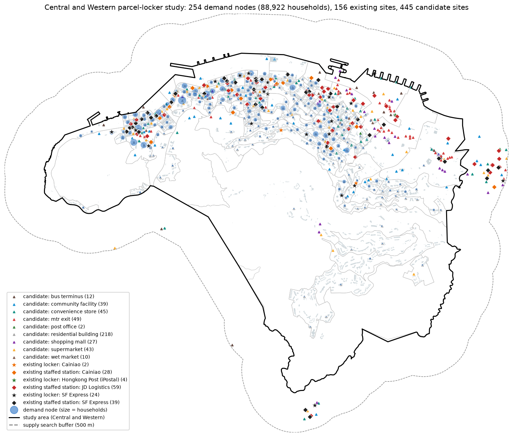

# Parcel Network Optimisation: Central & Western District

Where to put parcel lockers in Hong Kong's Central & Western District (SCLP / MCLP, simulation, sensitivity).
The research plan is in [Parcel Network Optimisation.md](Parcel%20Network%20Optimisation.md). The study started with Kennedy Town only and was widened to the whole district. To rerun the Kennedy Town-only version, set `STUDY_TPUS = ["111"]` in `pipeline/common.py`.

**Status:** All four sections of the research plan are done: data (§1), ILP location models (§2), stochastic simulation (§3), and sensitivity analysis and managerial insights (§4). We also added extensions from the course: a transportation LP with duals, a module-allocation MILP, goal programming, decision analysis (incl. two-way break-even), and a demand & capacity sensitivity study (demand–performance curves, marginal value of capacity, tornado, risk analysis, operating policies).

**📄 Full report: [`report/index.html`](report/index.html)**. It is a single self-contained page (figures embedded). Download it and open it in a browser, because GitHub shows HTML as source code.

## Modelling results at a glance

| Question | Answer |
|---|---|
| Coverage today (300 m walk) | 37.0% of households (20 public lockers) |
| Same 20 lockers, optimally placed | 82.5% (greenfield MCLP) |
| Best budget (MCLP elbow) | **22 new lockers → 86.7%**; 80% needs 13, 90% needs 30 |
| 100% coverage (SCLP) | 97 new lockers (25 public + 72 in-building). 11,208 households have no public site within 300 m |
| Capacity (transportation LP) | 80-compartment banks absorb only 23% of the ~9,337 locker parcels per day |
| Targeted vs uniform expansion (MILP) | +104 modules: 52.6% served (targeted) vs 41.4% (uniform) |
| Compartments for ≤2% overflow (simulation + Erlang B) | 14,080 normal · 25,920 at Double 11 (×2) |
| Equity (goal programming) | Every area ≥70% needs 35 lockers (14 in-building) |
| Distance vs slope-aware time (same standard, D/75 min) | Time standard needs 18–26 more lockers for 100%; distance-optimal 22-locker plan reaches 69.0% within 4 min vs 79.0% for the time-optimal plan |
| Sensitivity to demand (banks sized for ≤2%) | +10% demand → 4.3% rejected, +25% → 13.2%; headroom to 2% only +5% |
| Marginal value of capacity | A module at a saturated bank serves ~27 parcels/day; economic optimum 14,000 compartments (1.6% rejected) at HK$5/parcel, HK$15k/module-yr |
| Risk (all inputs uncertain) | Base sizing misses 2% in 60% of scenarios; robust P90 sizing 20,360 compartments → 15% |
| Operating policies (+50% surge) | Pick-up reminders cut rejection 25.9% → 10.3%; redirecting overflow → 25.6% |
| How many to build (decision analysis) | EMV → **build 35** (HK$2.42m/yr), maximin → build 22, EVPI HK$0.06m/yr |

Reproduce all models and the report in about two minutes: `.venv/bin/python models/run_all.py`. Outputs go to `results/` (CSV/JSON) and `figures/models/` (PNG).



For an interactive version, open [figures/study_area_map.html](figures/study_area_map.html) locally in a browser. Hover over any point to see its details.

## Headline numbers

| | |
|---|---|
| Study area | Central & Western District (official 2021-Census District Council District boundary, mainland part, 12.4 km²) |
| Demand nodes *i ∈ I* | **254** residential clusters (3,654 official Lands Department residential towers in 160 census Small Subunit Groups across 14 TPUs), holding **88,922 households / 235,953 residents**. These totals equal the official district totals exactly. |
| Existing sites | **156** within the district + 500 m buffer: SF Express (24 lockers + 39 staffed points), Cainiao (2 lockers + 28 stations), iPostal (4), JD (59, reference only). **87** of them form the public baseline. |
| Candidate sites | **445**: MTR exits (49), convenience stores (45), supermarkets (43), community facilities (39), malls (27), bus termini (12), wet markets (10), post offices (2), and in-building/estate-lobby sites (218) |
| Distance/time matrix *d_ij* | 254 × 601 pedestrian-network walking distances, **slope-aware** walking times, and climb (all pairs within 2 km) |
| Terrain | Demand nodes sit between 4 m and 467 m above sea level (The Peak). 25% of path segments are steeper than 10%. Slope adds 7% on average to walking times within 500 m. |
| Walking vs straight line | Median detour ratio **1.58** (90th percentile 2.64). Straight-line distance would put 178% more node–site pairs within 300 m than walking distance does. |

### Baseline coverage of the existing network (% of households)

| Walk to nearest site | 200 m | 300 m | 400 m | 500 m |
|---|---|---|---|---|
| **All public pick-up points** (SF, Cainiao, iPostal; 87 sites) | 52.1 | **73.3** | 81.4 | 86.4 |
| Lockers only (20) | 11.5 | **37.0** | 58.6 | 73.2 |
| Staffed points only (67) | 47.8 | 69.3 | 79.0 | 85.2 |
| SF Express, all (55) | 44.5 | 70.1 | 80.4 | 86.1 |
| SF Express lockers (16) | 11.3 | 34.4 | 56.8 | 70.2 |
| Cainiao (28) | 32.2 | 60.5 | 74.7 | 82.3 |
| iPostal (4) | 0.6 | 4.2 | 10.8 | 18.7 |

By slope-aware walking time, all public points cover 51.8% / 61.2% / 70.4% / 81.0% of households within 3 / 4 / 5 / 7 min.

**Where the gaps are** (households within 300 m of a public point, by TPU; area names are inferred from each TPU's largest buildings):

| TPU | Area (examples) | Households | All public points | Lockers only |
|---|---|---|---|---|
| 111 | Kennedy Town & Mount Davis (Smithfield Court, Kwun Lung Lau) | 22,668 | 90.7% | 49.1% |
| 112 | Shek Tong Tsui / Sai Ying Pun (Standard Mansion) | 20,858 | 94.6% | 44.9% |
| 113 | Sai Ying Pun / Sheung Wan (Lop Po Building, Centre Hollywood) | 10,013 | 78.2% | 30.2% |
| 114 | Sheung Wan (Centre Point) | 3,639 | 100.0% | 100.0% |
| 115 | Sheung Wan waterfront | 829 | 91.5% | 50.3% |
| 116 | Western waterfront (Belcher Court) | 4,998 | 97.6% | 68.7% |
| 121 | Central core (Sun Lee Building, Hung Kei Mansion) | 269 | 100.0% | 0.0% |
| 122 | Central / Soho (Hopson Mansion) | 2,403 | 79.4% | 37.0% |
| 124 | Admiralty / Garden Road | 238 | 51.0% | 0.0% |
| 141 | Mid-Levels West (2 Park Road) | 6,167 | **30.1%** | 8.0% |
| 142 | Mid-Levels (Carlos Court, Yee Lin Mansion) | 12,870 | **28.2%** | 4.0% |
| 143 | Mid-Levels East (Hoover Court, St. Louis Mansion) | 3,125 | **0.0%** | 0.0% |
| 181–182 | The Peak (Magazine Heights, Cloud Nine) | 844 | **0.0%** | 0.0% |

The low-lying west (Kennedy Town to Sheung Wan) is well served, mostly by staffed points. **The Mid-Levels and The Peak are poorly served**: about 22,000 households in TPUs 141–143 alone, where hillside walking makes every 100 m count. That is where the location models are likely to place new lockers.

Excluded from the baseline: residents-only lockers (e.g. SF's Cayman Rise and Cainiao's 只限住戶 lockers), JD (out of scope), and one JD row with a non-Hong Kong address.

## Repository layout

```
models/                      modelling stage (run_all.py runs m1..m6 then builds the report)
  mcommon.py                 data loading, coverage sets, SCLP/MCLP solvers (SciPy HiGHS), plot style
  m1_location_ilp.py         SCLP / MCLP, LP relaxation, radius & budget sensitivity, recommended plan
  m2_capacity_lp.py          transportation LP + shadow prices / RHS ranging, module MILP, NW/VAM demo
  m3_simulation.py           Monte Carlo overflow simulation, Erlang B check, sizing, Double 11
  m4_goal_programming.py     preemptive goal programming (equity vs coverage vs budget)
  m5_decision_analysis.py    payoff table, decision criteria, EMV / EVPI, one- & two-way break-even
  m6_demand_capacity.py      demand-performance curves, marginal value of capacity, tornado, risk analysis,
                             operating policies, replication confidence intervals
report/build_report.py       builds report/index.html from results/ and figures/
results/                     model outputs (CSV / JSON)
pipeline/                    run in order; each step reads the previous step's outputs
  common.py                  paths + ALL study & simulation parameters (study area, buffer, ...)
  01_fetch_raw.py            download raw data            -> data/raw/
  02_demand_nodes.py         boundary + demand nodes      -> data/processed/
  03_supply_sites.py         existing + candidate sites   -> data/processed/
  04_distance_matrix.py      walking distance/time matrix -> data/processed/
  05_maps.py                 overview maps                -> figures/
  06_qa_checks.py            data-quality checks          -> data/processed/qa_*.csv
data/
  raw/                       untouched downloads, DTM clip, ALS geocoder cache
  raw/operators/             SF / JD / Cainiao pick-up point lists, SF store list
  manual/existing_lockers.csv  hand-logged extra sites (only used if not in the operator lists)
  processed/                 model inputs (see below)
figures/                     study_area_map.png / .html
image.png                    source screenshot of SF Locker list (Kennedy Town)
```

### Reproduce

```bash
python3 -m venv .venv && .venv/bin/pip install -r requirements.txt
cd pipeline
../.venv/bin/python 01_fetch_raw.py      # skips files that already exist; --force to refresh
../.venv/bin/python 02_demand_nodes.py
../.venv/bin/python 03_supply_sites.py
../.venv/bin/python 04_distance_matrix.py   # ~1 min for the district
../.venv/bin/python 05_maps.py
../.venv/bin/python 06_qa_checks.py
```

The 29 MB whole-territory DTM zip is git-ignored. Step 01 re-downloads it if `data/raw/dtm/dtm_5m_study_bbox.tif` is missing.

## Processed outputs (what the models use)

| File | Contents |
|---|---|
| `demand_nodes.csv` | `node_id`, `lat`, `lon`, `households` (use as **h_i**), `population`, `daily_parcels` (λ_i, see below), source SSG (its first 3 digits are the TPU), buildings |
| `supply_sites.csv` | `site_id`, `site_class` (existing/candidate), `operator`, `category` (locker / staffed_station / mtr_exit / …), `name`, `lat`, `lon`, `in_study_area`, `public_access`, `include_baseline` |
| `distance_matrix_m.csv` | Wide matrix of walking metres (rows = `node_id`, cols = `site_id`; blank = more than 2 km). Use **a_ij = 1 if d_ij ≤ D_max**. |
| `walk_time_matrix_min.csv` | Same layout, slope-aware walking minutes |
| `distance_long.csv` | Long format, one row per pair within 2 km: `walk_m`, `walk_min` (slope-aware), `walk_min_flat`, `climb_m` (ascent home→site), `euclid_m`, `detour_ratio` |
| `geocode_report.csv`, `snapping_report.csv` | QA: geocoder match score and street check; distance from each point to the network; ground elevation |
| `qa_operator_coordinates.csv` | Each operator site's coordinates vs an independent ALS geocode of its Chinese address |
| `qa_network_gaps.csv` | District-wide OSM network issues near homes: dead-end lifts, disconnected path fragments, escalators in the network, detour outliers (with openstreetmap.org links) |
| `*.gpkg` | Same data as GIS layers (EPSG:2326, HK1980 Grid), for QGIS |

Useful filters for the models:
- **Existing baseline network:** `site_class == "existing" and include_baseline == "yes"`. Add `and category == "locker"` for lockers only.
- **Public candidates only:** drop `category == "residential_building"` (in-building lockers, residents only)
- **Sites outside the boundary** (`in_study_area == False`) are in J so that edge residents can be served across the boundary. Their demand is *not* counted.
- **Model size:** 256 × 450 candidates is small for PuLP/CBC. If you want a smaller instance, group nodes by TPU or drop in-building candidates.

## Methodology (draft text for the report)

**Study boundary.** The study area is Central & Western District, using the official 2021 Population Census District Council District boundary (C&SD). The uninhabited Green Island and Little Green Island are dropped. Demand comes from all 160 census Small Subunit Groups (SSGs) inside the district. Their households and population sum exactly to the published district totals (88,922 / 235,953). Supply sites are searched up to 500 m beyond the boundary, which equals the largest coverage radius in the sensitivity analysis. Residents near the edge can therefore be served by lockers just across it (e.g. in Wan Chai), which avoids edge-effect bias. Their demand is not counted.

**Demand nodes.** We use residential building clusters within census SSGs rather than coarse TPUs. This keeps the 300 m walking threshold accurate and avoids aggregation bias, while anchoring total demand to official 2021 Census figures. The steps are:
1. Take the official Lands Department building footprints (tower blocks only; podiums excluded) and assign them to their SSG. The building's use comes from **Buildings Department records** wherever one lies within 10 m of the tower: 5,564 of 7,984 towers, mostly private buildings. A tower is residential if any record says *Residential/Composite*. For the rest (mainly public housing and government buildings), a tower is dropped if it lies inside an OSM building tagged as a school, warehouse, office or similar, or if its name says so (e.g. depot, consulate). On the towers both methods cover, they disagree for 767, mostly offices that the OSM-based rule would have counted as homes; there the Buildings Department record is used.
2. Estimate each building's gross floor area as footprint × official storeys: 3,090 towers have an official storey count, and 564 are estimated from building height ÷ 3.43 m (the median storey height of towers that have both).

   *Why not OSM storeys?* In the Kennedy Town pilot, OSM `building:levels` differed from the official count by 6.3 storeys on average. Only 30% matched exactly (Manhattan Heights is tagged 3 storeys but has 51), and OSM was missing 128 towers.
3. Group buildings within each SSG by complete-linkage clustering (maximum diameter 150 m). Merge clusters with fewer than 50 households into the nearest cluster.
4. Split each SSG's Census households and population across its clusters in proportion to floor area. Census households count *domestic* households only, so institutional quarters (student halls, hostels, elderly homes) receive residents but no households.
5. Place each node on the building nearest its floor-area-weighted centroid.

**Supply sites.**
- **SF Express, Cainiao and JD:** machine-readable lists compiled from each operator's own website, last verified 2026-10-05, with coordinates. They are published by hillmalaya.com.hk at `data/raw/operators/pickup-points-*.js`; the header of each file documents its provenance. The coordinates agree with the government Address Lookup Service (ALS) to 5 decimal places on spot checks. Site type comes from the Chinese name: 櫃 (自助櫃/智能櫃) means locker, and everything else (驛站, 服務站, 順豐站, OK便利店 counters) is a staffed point. Lockers marked 只限住戶 or "Only for residents" are flagged as not public.
- **SF stores:** from SF's store list PDF, geocoded with ALS. A match must score at least 60 *and* share a street or building name with the query. A high score alone is not enough: "7 North Street Kennedy Town" scored 84 but matched "7 Praya".
- **iPostal Stations:** from Hongkong Post's official CSDI dataset.
- **Candidate sites:** OpenStreetMap points of interest where a locker could realistically go, de-duplicated within 25 m. Every demand node is also a candidate in-building (estate-lobby) locker, as in SF's residents-only lockers. This guarantees that the 100%-coverage SCLP is feasible (J ⊇ I).

**Walking distance and time.**
- **Distance:** shortest paths on the OpenStreetMap pedestrian network (OSMnx `network_type="walk"`, undirected), which includes stairs, footbridges and mapped lifts. Each distance also adds the straight-line access legs from each point to its nearest network node. Pairs ≤ 25 m apart use the straight-line distance. Pairs more than 2 km apart are not stored.
- **Elevation:** each network node takes its height from the Lands Department 5 m DTM.
- **Speed:** each edge's speed follows Tobler's hiking function, *v = v₀·e^(−3.5|s+0.05|)*, rescaled so that flat ground = 4.5 km/h (75 m/min, so 300 m ≈ 4 min).
- **Direction:** residents walk to the locker and back, so each edge's time is the mean of its uphill and downhill times (half the round trip). Tunnel edges are treated as flat, and grades are capped at ±50%.
- **How this connects to the 200–500 m standards:** `walk_m` (metres) never depends on slope, and every radius-D coverage model uses it (a_ij = 1 if walk_m ≤ D). Slope enters only through `walk_min`. Each distance standard D has a *time twin* T = D / 75 min (200 m = 2.7, 300 m = 4.0, 400 m = 5.3, 500 m = 6.7 min). On flat ground the two tests agree; on a hill the same distance takes longer. `m1` re-solves the SCLP and MCLP for every standard on both matrices (`results/m1_time_sweep.csv`, `m1_cross_evaluation.csv`).

## Simulation parameters (Section 3), starting values in `pipeline/common.py`

| Parameter | Value | Basis |
|---|---|---|
| Parcels per household per day | **0.35** (sensitivity range 0.20–0.50) | About 350 M e-commerce parcels in HK in 2025, ÷ **2.78 M households** (official: C&SD THS Report No. 82, 2024, where 2,691.4k households with internet = 96.7% of all) ÷ 365 = 0.345. That is about 2 parcels a week per online shopper (3.14 M people aged 15+, 49.6%, shopped online in 2024). The volume is a Statista figure cited second-hand ([zhbfwl.com](https://www.zhbfwl.com/en/case/hk-local-ecommerce-delivery)); we could not open Statista to verify it. **Replace with a primary source if possible.** |
| Share of parcels sent to lockers or pick-up points | 0.30 | **Assumption**, to be varied in the sensitivity analysis. Unsourced market reports put HK locker/pick-up adoption at 25–35% ([Mordor Intelligence](https://www.mordorintelligence.com/industry-reports/hong-kong-ecommerce-market), [CLEARgo](https://www.cleargo.com/insights/hong-kong-e-commerce-market-2026-trends-size-growth-opportunities)). In a KPMG/YouGov survey of 2,065 HK consumers (2022), 69% expected retailers to offer smart-locker delivery ([KPMG](https://assets.kpmg.com/content/dam/kpmg/cn/pdf/en/2022/11/retail-recharged.pdf)). |
| Dwell time (plan) | 60% collected within 24 h, 30% within 48 h, 10% within 72 h | Research plan |
| Dwell time (empirical benchmark) | median 4.2 h, mean 12.5 h, 84% within 24 h, 99% within 7 days | Urban Freight Lab residential-locker field study ([PDF](https://urbanfreightlab.com/wp-content/uploads/2023/05/Do-Lockers-Reduce-Delivery-Dwell-Time-Evidence-from-Field_UrbanFreightLab.pdf)). An Australia Post study of 51 lockers found dwell stabilising around 15–16 h ([arXiv 2409.05061](https://arxiv.org/html/2409.05061v2)). |
| Locker size (compartments) | 40 / 80 / 120 | Research plan |
| Peak surge | ×1.0 / ×1.5 / ×2.0 | Research plan |

Context: C&SD reports that the share of people aged 15+ who shop online rose from 35.8% (2018) to 43.1% (2020), 46.8% (2022) and **49.6% (2024)**. Among people aged 25–44 the 2024 figure is 77.8–83.8% ([THS Report No. 82](https://www.censtatd.gov.hk/wbr/B1130201/B11302012025XX02/att/en/B11302012025XX02.pdf); [THS 73 press release](https://www.info.gov.hk/gia/general/202104/15/P2021041500293.htm)).

## Data sources

| Data | Source |
|---|---|
| Census SSG boundaries, households, population | C&SD 2021 Population Census, Small Subunit Groups ([data.gov.hk](https://data.gov.hk/en-data/dataset/hk-censtatd-census_geo-2021-population-census-by-ssg), CSDI WFS `censtatd_rcd_1635933365202_19171`) |
| District boundary and official totals | C&SD 2021 Population Census, District Council Districts ([data.gov.hk](https://data.gov.hk/en-data/dataset/hk-censtatd-census_geo-2021-population-census-by-dcd), CSDI WFS `censtatd_rcd_1635932856094_19982`) |
| Building use | Buildings Department *Building information and age records* ([data.gov.hk](https://data.gov.hk/en-data/dataset/hk-bd-opendata-building-information)): point location, Tower/Podium, usage (Residential/Composite, Office/Commercial, Industrial, Others) |
| Building footprints and storeys | Lands Department *Building* layer ([data.gov.hk](https://data.gov.hk/en-data/dataset/hk-landsd-openmap-landsd-building), CSDI WFS `landsd_rcd_1637211194312_35158`) |
| Terrain | Lands Department 5 m Digital Terrain Model ([data.gov.hk](https://data.gov.hk/en-data/dataset/hk-landsd-openmap-5m-grid-dtm)), ±5 m accuracy. It includes elevated roads and bridges. |
| SF / Cainiao / JD pick-up points | [hillmalaya.com.hk pick-up points finder](https://hillmalaya.com.hk/pages/pick-up-points-finder-for-jd-logistics-cainiao-sf-express) data files (compiled from the operators' sites, last verified 2026-10-05). SF Kennedy Town lockers are also cross-checked against `image.png`. |
| SF stores | SF store list PDF, Hong Kong Island (2026-10-29) |
| iPostal Stations | Hongkong Post ([data.gov.hk](https://data.gov.hk/en-data/dataset/hk-hkpo-hkpo_ds01-hkpo-ipostal-station), CSDI WFS `hkpo_rcd_1639010988627_23643`) |
| Geocoding | HKSAR Address Lookup Service, [als.gov.hk](https://www.als.gov.hk) |
| Building use (non-residential mask), POIs, pedestrian network | © OpenStreetMap contributors (ODbL), via Overpass / OSMnx |
| Cross-check | [Centamap census by building group](https://census.centamap.com/Region/List?type=hma&code=HMA111&detailcode=CW0071) (Kennedy Town) |

## Quality checks (step 06)

- **Operator coordinates are reliable.** We independently geocoded each existing site's Chinese address with ALS. Where ALS matched the same street or building (130 of 150 sites), the gap to the operator coordinate is 0 m at both the median and the 90th percentile. No SF or Cainiao site differs by more than 100 m; only 4 JD points do (JD is reference only). The other 20 sites are inconclusive because ALS matched a different place, not because the operator coordinates are wrong. Two JD rows for mainland test lockers (address 華志路) are excluded.
- **Pedestrian network:** the main network has 61,133 of 63,693 unsimplified nodes. The **Central–Mid-Levels Escalator** (22 ways, 597 m) and the Centre Street escalators are connected. Near homes, the QA lists 50 detached path fragments, 14 dead-end lifts and 26 demand nodes whose nearest sites are close in a straight line but far on foot. All are in `qa_network_gaps.csv` with map links. Each is a possible missing link that would make walking distances too long. They are left as they are rather than guessed.

## Open items / limitations

- [ ] **Network gaps in `qa_network_gaps.csv`:** check the 14 dead-end lifts and the 26 detour outliers (including Kwun Lung Lau) on site or in street imagery, and fix them in OSM. Each fix shortens real walking distances.
- [ ] **Cainiao lockers may be undercounted.** Cainiao HK reports 1,000+ self-pickup lockers territory-wide ([unwire.hk](https://unwire.hk/2025/04/29/cainiaohongkong/life-tech/)), but its own list has 278, only 2 of them in this district (both residents-only). Only the Cainiao app can confirm this.
- [ ] **Parcel volume:** the 350 M parcels/year figure is still secondary, although its denominator is now official. No official parcel count or purchase frequency is published.
- [ ] **Locker share (0.30)** is an assumption, consistent with unsourced industry estimates of 25–35%. Vary it in the sensitivity analysis.
- [ ] **Alfred24:** skipped (no public list).
- [ ] **DTM caveats:** ±5 m accuracy, and it includes elevated structures. We damp the noise by capping grades and treating edges shorter than 5 m as flat.
- [ ] **Public housing and government buildings** have no Buildings Department record, so their use falls back to OSM tags and names (435 of 3,654 residential towers).
